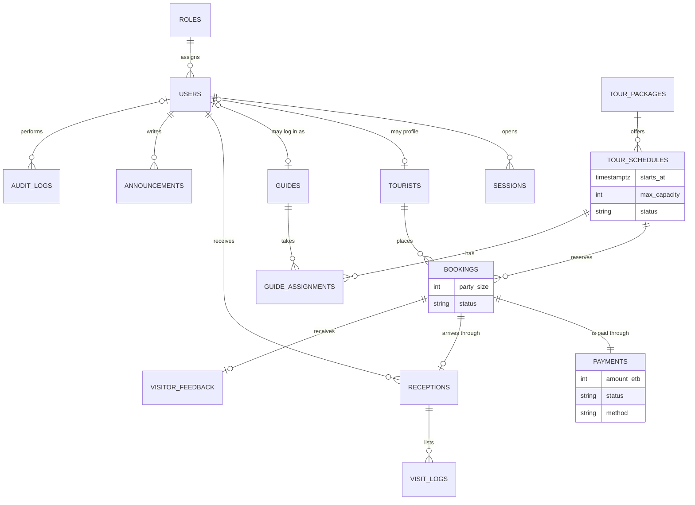

# Database design

PostgreSQL is the application database. The tables below are created by `database/migrations/001_init.sql` and `database/migrations/002_auth_roles.sql`. Development rows are inserted by `npm run db:seed`.

Phase 1 had an empty SQLite file and no tables. That file is unused. Nothing was copied out of it because it contained no application records.

## How the names map to the earlier model

| Earlier name | Table now | Reason |
| --- | --- | --- |
| User | `users` | Account: email, password hash, and one role |
| Role | `roles` | Four login roles: `administrator`, `tourist`, `tour_guide`, `receptionist` |
| Tour | `tour_packages` | The bookable offering: name, description, price in ETB |
| Visit date on a booking | `tour_schedules` | A package on a specific start time, with its own capacity |
| Tourist account | `tourists` | The customer profile a booking belongs to. A registered tourist also has a `users` row |
| Visitor at the desk | `visit_logs` | Each person who actually arrives. A guest does not need an account |
| Payment | `payments` | One payment row for one booking |
| Guide | `guides` | A person who can lead a tour. A tour-guide account also has a `users` row |
| Guide assignment | `guide_assignments` | Which guide is assigned to which schedule |
| Reception | `receptions` | One front-desk arrival for a booking, recorded by a receptionist or administrator |
| Session | `sessions` | Server-side sign-in. Logout sets `revoked_at` |

`visitor_feedback`, `announcements`, and `audit_logs` store reviews, public notices, and a history of important actions.

## Tables

| Table | Purpose | Important rules |
| --- | --- | --- |
| `roles` | Administrator, tourist, tour guide, and receptionist | `name` is unique |
| `users` | Accounts | Unique lowercase email, password hash, status `active` or `inactive` |
| `tourists` | Customer profile | Optional unique `user_id` for a registered visitor |
| `tour_packages` | Tour listing | Unique name, whole-ETB price from 0 to 1,000,000, duration from 1 to 1,440 minutes, optional group size, status `active`, `inactive`, or `archived` |
| `tour_schedules` | One departure | Unique package + start time, `max_capacity` greater than 0, end time after start |
| `bookings` | A tourist reserving seats | Party size greater than 0. Unique reference `AJ-` plus digits. Status `pending`, `confirmed`, or `cancelled`. A cancelled row records `cancelled_at`. See [BOOKING.md](BOOKING.md) |
| `payments` | Money recorded for a booking | Exactly one row per booking. Status `unpaid` or `paid`. Method `cash` or `transfer`. See [PAYMENTS.md](PAYMENTS.md) |
| `tickets` | One entry ticket for a paid booking | Unique token. Status `valid` or `void`. A valid ticket requires a paid booking that is not cancelled |
| `guides` | Tour leaders | Optional link to a user. Phone is unique when present |
| `guide_assignments` | Guide on a schedule | One active guide per departure. Earlier assignments stay as `replaced` or `removed`. See [GUIDES.md](GUIDES.md) |
| `receptions` | Desk arrival for a booking | One arrival row per booking and one per ticket. `received_by` must be an active receptionist or administrator. Check-in is allowed only on the scheduled visit date. See [CHECKIN.md](CHECKIN.md) |
| `sessions` | Sign-in sessions | Belong to one user. Logout sets `revoked_at` |
| `visit_logs` | People who arrived | Belong to one reception |
| `visitor_feedback` | One review for a booking | Rating from 1 to 5 |
| `announcements` | Palace notices | `draft` or `published` |
| `audit_logs` | Who did what | `user_id` may be empty if the account is later removed |
| `schema_migrations` | Applied SQL files | Used by the migration runner |

`created_at` is on every table. `updated_at` is maintained automatically on the tables that can change.

## Relationships

Deleting a booking is blocked while a payment, reception, or review still points at it. Cancel a booking by setting its status to `cancelled` instead of deleting the row.

## Booking integrity

These rules are enforced by the database, so a later API cannot bypass them.

1. **Capacity.** `tour_schedules.max_capacity` is the maximum party size that can be held at once. `pending` and `confirmed` bookings count. `cancelled` bookings do not. A trigger locks the schedule row and rejects the write with `booking_capacity_exceeded` when the total would be too high.
2. **One active booking.** A tourist cannot have two `pending` or `confirmed` bookings for the same schedule. Cancelling the first booking allows a new one.
3. **Open schedule.** A booking can be added only while the schedule status is `scheduled`.
4. **Payment in the same transaction.** After a booking insert commits, a payment row for that booking must exist. The check waits until the end of the transaction, so the application can insert the booking and then the payment. `bookTour` in `server/src/repositories/booking.repository.ts` does both inside one transaction and locks the schedule first.
5. **Who records a payment or arrival.** `payments.recorded_by` and `receptions.received_by`, when set, must be an active receptionist or administrator.
6. **No card data.** A payment stores an amount, a status, and `cash` or `transfer`. It does not store card numbers or a payment-provider secret.

Two visitors booking the last seats at the same time are serialized by the schedule lock. One transaction commits. The other receives `booking_capacity_exceeded` and rolls back, including its payment insert.
