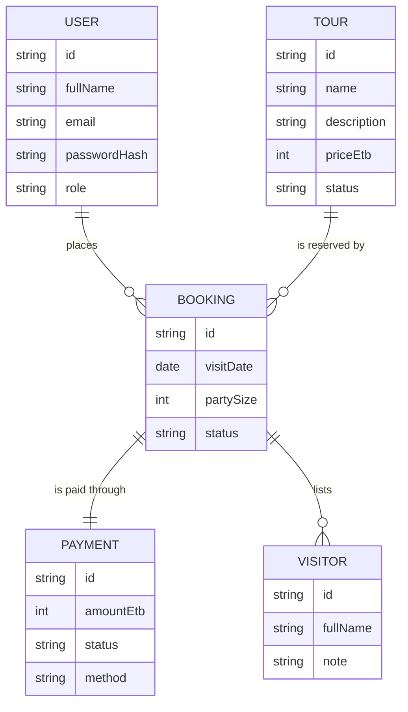

# Database design

This is the conceptual model for the website. It names the records the requirements need and how they relate. It is not the physical schema. Phase 1 does not create tables, columns, or migrations.

Confirm the [working assumptions](SYSTEM_REQUIREMENTS.md#working-assumptions) before turning this diagram into SQL.

## Entities

### User

A person with an account. Holds the name, email, password hash, and role (`visitor`, `staff`, or `administrator`). The password itself is never stored.

### Tour

A bookable visit offering at Abba Jifar Palace. Holds the name, a short description, the price in ETB, and whether the listing is active. Administrators maintain tours.

### Booking

A visitor’s reservation of one tour on one date, for a party of a given size. Holds the visit date and a status such as `pending`, `confirmed`, or `cancelled`. A booking belongs to the user who created it and to one tour.

### Visitor

A person expected on a booking. A booking can list more than one visitor. Staff use these records at the palace. A visitor row is not the same thing as a user account: a visitor may be a guest who never signs in.

### Payment

The amount charged for one booking and whether it is `unpaid` or `paid`. One booking has one payment record in this first model. Staff update the status when money is received at the palace. No card number or payment-provider secret is stored.

## Relationships

- One user places zero or many bookings.
- One tour is booked zero or many times.
- One booking has one payment.
- One booking lists zero or many visitors.
- Users do not own tours. Tours are palace listings managed by administrators.

## Open point for the next phase

The diagram stores the visit date on the booking. It does not yet limit how many people can book the same day. If the palace needs a daily capacity, add a schedule row (tour + date + remaining places) before coding bookings. That decision changes the booking rules, so it should be settled when the schema is written.

## What will be added later

- Primary keys, foreign keys, and unique email.
- `NOT NULL` rules and allowed values for role, booking status, and payment status.
- A short SQL script or migration under `database/`.
- A seed administrator account, with the password supplied locally and never committed.
