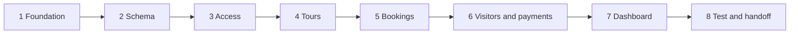

# Implementation roadmap

The target is a usable website in about 24 hours. Each phase ends with something the team can run. Later phases depend on earlier ones, so the order matters.

Phase 1 is the environment. Phase 2 is the PostgreSQL schema and seed data. Feature screens start at Phase 3, after review of this database foundation.

## Essential path

These phases are the product. Rough times assume one small team working in Cursor, and they include fixing what breaks. The sum is about 20 hours, which leaves a buffer inside the 24-hour target.

| Phase | Work | Depends on | About |
| --- | --- | --- | --- |
| 1. Foundation | Tooling, folders, docs, health check, database connection | — | Done |
| 2. Schema | PostgreSQL tables, keys, capacity rules, migration, and seed data | Phase 1 | Done |
| 3. Access | Register, sign in, password hashing, role checks on the server | Phase 2 | Done |
| 4. Public site | Palace introduction, gallery, visit information, announcements, and tour themes. Administrator tour editing comes later | Phase 3 | Done on this branch |
| 5. Bookings | A visitor books a tour and date. Staff can see all bookings. A visitor sees only their own | Phase 4 | 4 hours |
| 6. Visitors and payments | Staff record people on a booking and mark it unpaid or paid | Phase 5 | 3 hours |
| 7. Dashboard | Staff and administrator screens that use the records from phases 5 and 6 | Phase 6 | 3 hours |
| 8. Test and handoff | Walk through every role, fix breakages, and update the README with anything that changed | Phase 7 | 2 hours |

### Module order

Bookings need tours and accounts. Visitor records and payments need a booking to attach to. The dashboard needs those records to exist, so it comes after them rather than as an empty shell in the middle.

## What “done” means for the essential path

- A visitor can register, sign in, read tours, create a booking, and open that booking again.
- A staff member can find the booking, add the people attending, and mark the payment paid or unpaid.
- An administrator can manage tours and roles, and can do the staff tasks.
- The server rejects a visitor who tries a staff action.
- The team has clicked through those paths in the browser.

## Optional improvements

Do these only after the essential path works. They are outside the agreed first scope.

| Improvement | Why it can wait |
| --- | --- |
| Extra schedule controls in the dashboard | The database already rejects a booking that would pass the schedule capacity |
| Afaan Oromo and Amharic | The first version is English |
| Email or SMS confirmations | Needs an external sender |
| Card or mobile-money payments | The first version records payment at the palace |
| Photo uploads | Bookings do not need files to be usable |
| Charts on the dashboard | Lists are enough for the first handover |
| Production hosting and a custom domain | After the local walkthrough in Phase 8 |

## How to work each phase

1. Re-read the requirement IDs that phase covers in [SYSTEM_REQUIREMENTS.md](SYSTEM_REQUIREMENTS.md).
2. Branch from `main` with `feature/<phase-name>`.
3. Implement the smallest version that satisfies those IDs.
4. Run `npm test` and `npm run typecheck`.
5. Click through the new path in the browser before calling the phase done.
6. Ask for review, then merge. Do not start the next feature phase on a broken `main`.
