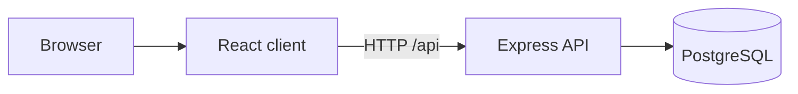
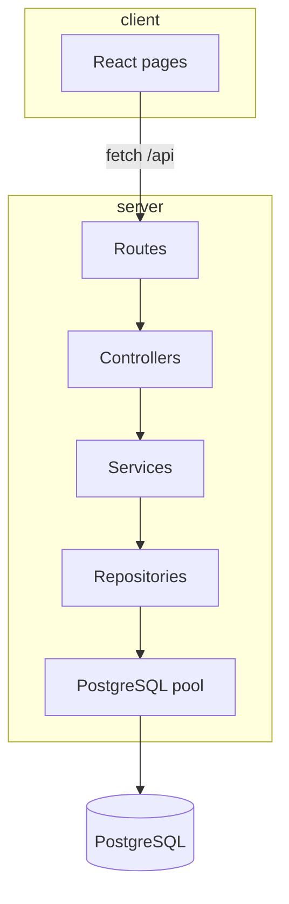

# System architecture

## Overview

The website is two programs in one repository:

- a **React** frontend that runs in the browser
- an **Express** API that enforces rules and talks to **PostgreSQL**

The browser never opens the database. It calls the API. The API is the only component that reads and writes records.

## Frontend

The client lives in `client/`. Vite compiles React and TypeScript and serves the development site at `http://localhost:5173`.

The frontend is responsible for:

- pages and forms
- calling the API
- showing data the API returns

The frontend is not responsible for deciding who is allowed to do something. It can hide a link, and the API still checks the role.

During development, Vite forwards any request that starts with `/api` to `http://localhost:4000`. The browser sends the session cookie with those requests because the proxy makes them same-origin. The home page calls `/api/health`. Sign-in, tourist registration, profile, and the role areas live in `client/src/pages/`.

## Backend

The API lives in `server/`. A request travels through a short, fixed path:

1. `src/routes/` matches the URL.
2. `src/controllers/` reads the request and sends the response.
3. `src/services/` holds the business rules for that request.
4. `src/repositories/` reads and writes tables.
5. `src/config/database.ts` holds the PostgreSQL connection pool.

Validation for account input is in `src/validation/auth.ts`. Password hashing, session tokens, and login lockout are in `src/security/`. Authentication middleware is in `src/middleware/authenticate.ts`. Database errors and transactions are in `src/db/`.

Shared response shapes live in `shared/src/` so the client and the server name the same fields.

The public route `GET /api/health` returns the service name, the time, and whether PostgreSQL accepted `SELECT 1`. Account routes live under `/api/auth`. Role checks live under `/api/admin`, `/api/guide`, and `/api/reception`.

`bookTour` is a repository function for a later booking route. It is not exposed as an HTTP endpoint yet. It locks the schedule, inserts the booking, and inserts the payment in one transaction. The database triggers described in [DATABASE_DESIGN.md](DATABASE_DESIGN.md) still apply if a future route writes SQL directly.

## Database

PostgreSQL is the selected database. Many tourists and staff can book and update records at the same time. A transaction can lock one tour schedule, so two people cannot take the last seats together. Foreign keys keep payments, visitors, and bookings attached to real rows.

The Windows PostgreSQL 18 service is already installed on port 5432, and its administrator password is not available to this project. `npm run db:up` therefore starts a second cluster with the same PostgreSQL programs, on port 5433, and stores its files in `database/pgdata`. That folder is gitignored. The service on port 5432 is left unchanged.

`DATABASE_URL` in `.env` is the only connection setting the API reads. There is no database password in source code.

Schema changes are SQL files in `database/migrations/`. `npm run db:migrate` records each applied file in `schema_migrations` and skips files that already ran. `npm run db:seed` inserts the development administrator, roles, tour packages, schedules, and guides. New passwords are bcrypt hashes. The original development administrator may still have the scrypt hash created in Phase 2; `verifyPassword` accepts both.

### Why this database

| Option | Fit for this project |
| --- | --- |
| PostgreSQL on this computer | Transactions, row locks, and foreign keys fit simultaneous bookings. The programs are already installed. **Selected.** |
| SQLite | Used in Phase 1 to prove a connection. It does not lock and isolate concurrent bookings as safely as PostgreSQL. The old file had no tables and is no longer used. |
| A hosted database | Adds an account and a network dependency. The project stays on a free local server. |

## Authentication and authorization

Sign-in uses an httpOnly cookie named `abba_session`. The cookie holds an HS256 token signed with `JWT_SECRET`. The token contains the user id, the session id, and an expiry. The `sessions` table is the source of truth: logout sets `revoked_at`, and a copied token stops working.

This fits the site better than a token stored in browser script. The React app never reads the secret, and a script on the page cannot read the cookie. The Vite proxy keeps the cookie on `localhost:5173` during development.

- Roles are `tourist`, `tour_guide`, `receptionist`, and `administrator`.
- Public registration always creates a tourist, even if the request asks for another role.
- An administrator creates guide, receptionist, and administrator accounts with `POST /api/admin/users`.
- `authenticate` rejects a missing, expired, or revoked session with `401`. `authorize` rejects the wrong role with `403`. An administrator does not automatically pass a guide-only or receptionist-only check.
- Five failed sign-in attempts for one email lock that email for 15 minutes.
- `JWT_SECRET` is required in `.env` and must be at least 32 characters. It is not committed.

A payment recorder and a reception arrival must reference an active receptionist or administrator. The database trigger enforces that independently of the API.

## How the pieces communicate

Today the only HTTP conversation is the health check:

1. The page requests `GET /api/health`.
2. Vite proxies that request to Express.
3. The health controller asks the health service for a status object.
4. The service runs `SELECT 1` through the connection pool.
5. Express returns JSON. The page prints the status, service name, database result, and time.

## What exists after Phase 2

- The Phase 1 placeholder page and `GET /api/health` still work, now against PostgreSQL.
- The schema, migration, seed command, and booking integrity rules exist.
- Sign-in, booking screens, payments, and the dashboard are not HTTP features yet.
