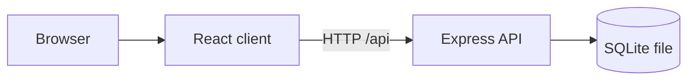
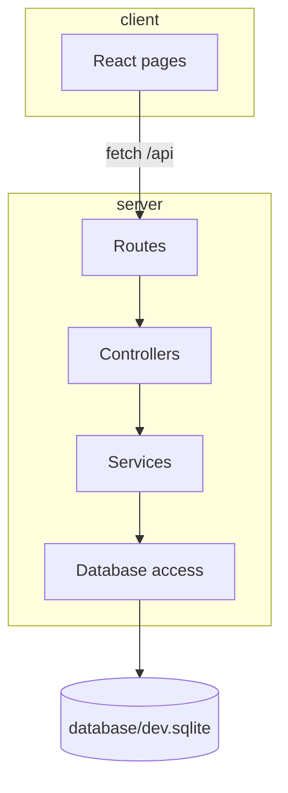

# System architecture

## Overview

The website is two programs in one repository:

- a **React** frontend that runs in the browser
- an **Express** API that enforces rules and talks to a **SQLite** database

The browser never opens the database. It calls the API. The API is the only component that reads and writes records.

## Frontend

The client lives in `client/`. Vite compiles React and TypeScript and serves the development site at `http://localhost:5173`.

The frontend is responsible for:

- pages and forms
- calling the API
- showing data the API returns

The frontend is not responsible for deciding who is allowed to do something. It can hide a link, and the API still checks the role.

During development, Vite forwards any request that starts with `/api` to `http://localhost:4000`. The placeholder page calls `/api/health` on that proxy.

## Backend

The API lives in `server/`. A request travels through a short, fixed path:

1. `src/routes/` matches the URL.
2. `src/controllers/` reads the request and sends the response.
3. `src/services/` holds the business rules.
4. `src/config/database.ts` opens SQLite.

Shared response shapes live in `shared/src/` so the client and the server name the same fields.

Phase 1 implements one route: `GET /api/health`. It returns the service name, the time, and whether the database accepted `SELECT 1`.

## Database

`server/src/config/database.ts` opens the file in `DATABASE_PATH` using Node.js `node:sqlite`. The default file is `database/dev.sqlite`. The server creates the file if it is missing.

Phase 1 does not create tables. The entities and relationships are in [DATABASE_DESIGN.md](DATABASE_DESIGN.md). The next phase adds the tables.

### Why this database

| Option | Fit for this project |
| --- | --- |
| SQLite through `node:sqlite` | Relational, built into Node.js 22.13+, no extra install. This machine can run it now. **Selected for development.** |
| PostgreSQL | Strong fit for many concurrent staff later. PostgreSQL is not installed here, and Docker Desktop is not running, so it could not be verified in this phase. |
| A hosted database | Adds an account and a network dependency. The brief prefers local, free tools. |

The table design uses ordinary relational ideas. A later phase can move the same tables to PostgreSQL if the team installs it.

## Authentication and authorization

Not built in this phase. The intended approach, so later work has one place to put it:

- A visitor registers with email and password.
- The server stores a password hash, never the password.
- Sign-in returns a signed token (JWT). The client sends that token on later requests.
- The API middleware reads the token, loads the role, and rejects forbidden actions with `403`.
- Roles are Visitor, Staff, and Administrator, as listed in [SYSTEM_REQUIREMENTS.md](SYSTEM_REQUIREMENTS.md).
- `JWT_SECRET` will live in `.env`. The example file reserves the name and the server does not read it yet.

Authentication code will sit in `server/src/` beside the existing routes, controllers, and services. It will be added when that phase starts, rather than as empty folders now.

## How the pieces communicate

In Phase 1 the only conversation is:

1. The page requests `GET /api/health`.
2. Vite proxies that request to Express.
3. The health controller asks the health service for a status object.
4. The service runs `SELECT 1` through the database module.
5. Express returns JSON. The page prints the status, service name, database result, and time.

When features arrive, the same path applies: the page calls `/api/...`, a route and controller accept it, a service applies the rule, and the database module runs SQL.

## What exists after Phase 1

- The client shows a placeholder page and the health result.
- The API answers `GET /` and `GET /api/health`.
- The database connection can be opened and checked.
- Accounts, tours, bookings, visitors, payments, and dashboards are documented and not coded.
